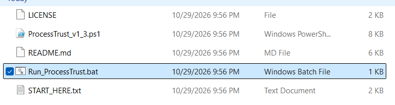
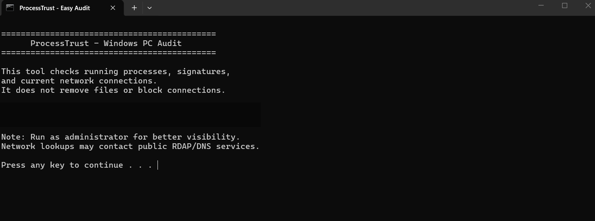
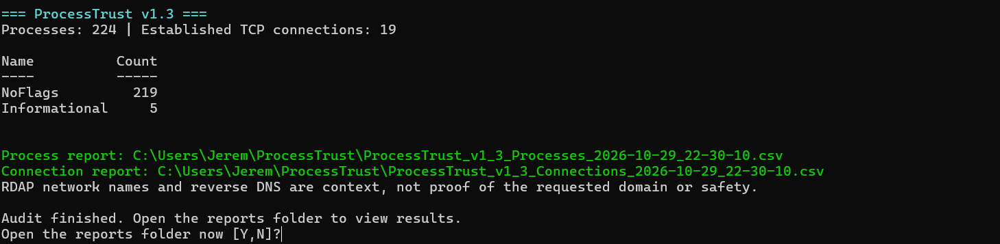
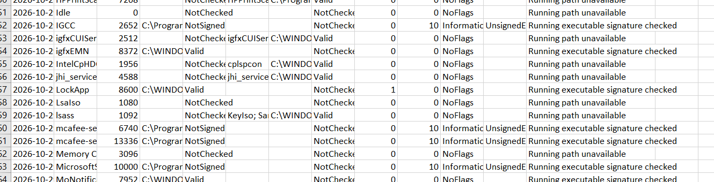

# ProcessTrust Auditor

**A Windows process and network auditing tool I built with PowerShell.**

ProcessTrust Auditor collects information about running processes, digital signatures, and active TCP connections. It also looks up information about remote IP addresses to help with investigations.

I built it as part of **HereTryingToProvideSolutions (HTTPS)**, where I document cybersecurity problems I investigate and the tools I build along the way.

## Why I Built This

I started by looking into unfamiliar processes and network connections on my own Windows computer. I kept switching between PowerShell commands and IP lookup tools to figure out what I was seeing.

I wanted a way to collect that information in one place, save the results, and have something I could investigate further. ProcessTrust is my attempt to do that.

## What It Does

- Lists running Windows processes and their process IDs (PIDs).
- Checks digital signatures on executable files it can access.
- Records associated Windows services when that information is available.
- Lists established TCP connections, including remote IP addresses and ports.
- Uses reverse DNS and RDAP lookups to provide more information about remote addresses.
- Assigns scores and review priorities based on the rules in the script.
- Saves process and connection reports as CSV files.
- Includes a Windows batch file so you can start the audit without typing a PowerShell command.

## Getting Started

### Requirements

- Windows with PowerShell 5.1 or later
- Internet access for the network lookups
- Permission to inspect processes and network connections
- Excel or another program that can open CSV files (optional)

### How to Run

1. **Download:** At the top of this repository, click **Code**, then **Download ZIP**.
2. **Extract:** Find `ProcessTrust-Auditor-main.zip` in Downloads, right click it, and choose **Extract All**. Open the extracted folder. **Do not run the launcher from inside the ZIP file.**
3. **Start the audit:** Double click `Run_ProcessTrust.bat`. Read the message in the command window and press a key when prompted. Give the audit time to finish, especially while it performs network lookups.
4. **Open the reports:** When prompted, type **Y** and press **Enter**. Open the CSV files and check the report timestamps and command window for errors.

Running as administrator may allow the script to inspect more processes. As with any downloaded script, read the code before running it.

## Screenshots From My Test

These screenshots show an actual run on my Windows 11 computer. Results will be different on other systems.

### 1. Extract the files

Find `Run_ProcessTrust.bat` in the extracted folder.

### 2. Start the audit

Read the startup message and follow the prompt.

### 3. Check the summary

In this test, ProcessTrust recorded **224 processes** and **19 established TCP connections**. It reported **219 `NoFlags`** and **5 `Informational`** process findings.

### 4. Investigate a finding

Two McAfee processes received a `RiskScore` of **10** because the signature check on their executable files returned `NotSigned`.

**A score of 10 does not mean a process is malicious or has a 10 out of 10 danger rating.** I used additional PowerShell commands to check the executable paths, Windows application package, antivirus status, and software provisioning before drawing a conclusion.

[Read my McAfee investigation, including the commands and results](McAfee-Investigation.md).

## Understanding the Reports

ProcessTrust creates two CSV reports:

- **Process report:** Process names, PIDs, file paths, signature results, Windows services, connection counts, scores, and review priorities.
- **Connection report:** Process details, local and remote addresses and ports, TCP states, reverse DNS results, and RDAP information.

You can open these reports in Excel, widen the columns, and filter the results to investigate specific entries.

## What the Scores Mean

- **`NoFlags`:** The script did not find any of the conditions it currently checks for. This does not guarantee a process is safe.
- **`Informational`:** Something met one of the script's review conditions and may be worth checking.
- **Higher priorities:** Other conditions or combinations of conditions may need closer attention, depending on the scoring rules.

These scores help decide what to look at next. They are not malware detections or percentages of risk. An unsigned executable is not automatically malicious.

## Another Example: LockApp.exe

During development, I found an established TCP connection involving the Windows lock screen process, `LockApp.exe`, and a public IP address on port 80.

I checked the executable path, verified its Microsoft signature, and used RDAP to identify Fastly as the network operator. I did not find evidence that established malicious activity. The RDAP result identified the network operator, not the exact website or content involved in the connection.

## Limitations

- ProcessTrust is not antivirus software or an intrusion detection system.
- It collects a snapshot of activity. It does not monitor connections continuously.
- Some protected processes may not provide all their information.
- A valid digital signature does not guarantee safe behavior, and an unsigned file is not automatically dangerous.
- RDAP provides network registration details, not the exact website visited.
- Reverse DNS information may be unavailable. The script does not capture URLs or network content.
- Results depend on the current rules in the script.
- The launcher may display a completion message even if the script encountered an error. Check the command output and make sure the CSV reports have new timestamps.

## Skills I Practiced

Windows process investigation, PowerShell scripting, digital signature checks, TCP/IP connections, DNS, RDAP, investigating suspicious findings, and exporting evidence to CSV files.

## What I Want to Improve

I'd like to add better checks for Windows application packages, make the scoring labels clearer, collect more process details, improve how the launcher handles errors, and eventually explore optional network monitoring.

These are ideas for future versions, not features in v1.3.

## License

This project uses the MIT License. See [LICENSE](LICENSE).

---

**HereTryingToProvideSolutions (HTTPS)**

*Learning cybersecurity by investigating problems, building tools, and testing what works.*
